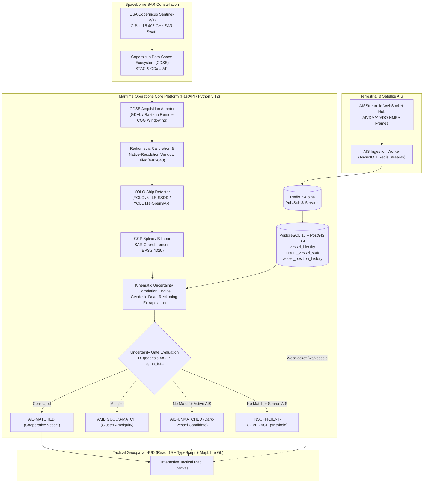

# Maritime Operations AI: Satellite SAR & Kinematic AIS Intelligence

[](https://www.python.org/)
[](https://fastapi.tiangolo.com/)
[](https://react.dev/)
[](https://postgis.net/)
[](https://redis.io/)
[](https://docs.ultralytics.com/)
[]()
[]()

A production-grade, open-source maritime operations platform engineered for **real-time situational awareness**, **AI weather-aware voyage optimization**, and **satellite Synthetic Aperture Radar (SAR) dark-vessel intelligence**.

---

## 📑 Table of Contents

1. [Executive Summary & Core Capabilities](#-executive-summary--core-capabilities)
2. [End-to-End System Architecture](#-end-to-end-system-architecture)
3. [Satellite Radar Intelligence & Detection Pipelines](#-satellite-radar-intelligence--detection-pipelines)
   - [Ground Range Detected (GRD) Native-Resolution Pipeline](#1-ground-range-detected-grd-native-resolution-pipeline)
   - [Single Look Complex (SLC) Burst Pipeline](#2-single-look-complex-slc-burst-pipeline-opt-in)
4. [Kinematic AIS Ingestion, Dead-Reckoning & Uncertainty Correlation](#-kinematic-ais-ingestion-dead-reckoning--uncertainty-correlation)
   - [Mathematical Uncertainty Formulation](#mathematical-uncertainty-budget--gating)
   - [5-State Correlation Classification](#5-state-dark-vessel-classification-taxonomy)
5. [AI Weather-Aware Routing & Hydrodynamics](#-ai-weather-aware-routing--hydrodynamics)
6. [Empirical Model Benchmarks & Validation](#-empirical-model-benchmarks--validation)
7. [Repository Structure](#-repository-structure)
8. [Installation & Setup Guide](#-installation--setup-guide)
9. [Running Automated Verification Suites](#-running-automated-verification-suites)
10. [Operational Constraints, Limitations & Ethics](#-operational-constraints-limitations--ethics)

---

## 🎯 Executive Summary & Core Capabilities

Maritime domain awareness (MDA) is critically compromised when non-cooperative vessels intentionally disable or spoof their **Automatic Identification System (AIS)** transponders to evade detection—a phenomenon known as **Dark Vessels**. 

**Maritime Operations AI** solves this operational challenge by cross-referencing all-weather spaceborne **Copernicus Sentinel-1 Synthetic Aperture Radar (SAR)** imagery against high-throughput terrestrial and satellite AIS broadcast streams. By projecting radar detections into precise WGS84 coordinates and computing geodesic dead-reckoning extrapolations with dynamic kinematic uncertainty budgeting, the platform reliably distinguishes cooperative traffic from dark-vessel candidates.

### Primary Capabilities:

1. **Dark-Vessel Detection & Georeferencing Pipeline**:
   - Automated catalog discovery and remote window streaming of Sentinel-1 C-band SAR scenes via the **Copernicus Data Space Ecosystem (CDSE)**.
   - Dual-modality support: **Level-1 GRD** (10m ground range detected) and **Level-1 SLC** (single-look complex IW bursts).
   - Zero-downsampling native-resolution sliding window tiling ($640 \times 640$ pixels, 20% overlap).
   - Sub-15m accuracy geocoding using STAC Ground Control Points (GCPs) with Thin Plate Spline (TPS) / piecewise bilinear interpolation.
   - High-performance ship detection powered by `YOLOv8s-LS-SSDD-v1.0` (83.8% precision, 71.5% $\text{mAP}_{50}$) and `YOLO11s-OpenSAR-SLC`.

2. **Kinematic AIS Ingestion & Spatial Dead-Reckoning**:
   - Real-time ingestion of live global maritime traffic from `AISStream.io` via asynchronous WebSockets.
   - Decoupled storage into PostGIS 3.4 (`vessel_identity`, `current_vessel_state`, and spatial deadband-thinned `vessel_position_history`).
   - Dynamic error ellipsoid propagation accounting for transponder clock jitter, sensor accuracy, and velocity dispersion.
   - Rigorous 5-state correlation classification with geographic receiver coverage awareness.

3. **AI Weather-Aware Voyage Routing**:
   - Global maritime navigation graph derived from Eurostat / SeaRoute certified international shipping lanes.
   - Deep-learning **Temporal Fusion Transformer (TFT)** surrogate model predicting vessel speed loss ($\Delta V$) under real-time marine weather stress (Open-Meteo wave, wind, and ocean currents).
   - Hydrodynamic propulsion and fuel consumption modeling using Holtrop-Mennen resistance and IMO Fourth GHG SFOC curves.

4. **Interactive Geospatial Tactical HUD**:
   - High-performance single-canvas interface built on React 19, Vite, and MapLibre GL.
   - Real-time WebSocket streaming of live AIS vessel clusters with viewport-bounded spatial querying.
   - Interactive SAR swath overlays, detection bounding boxes, vessel chips, and correlation inspection drawers.

---

## 🏛 End-to-End System Architecture



---

## 🛰 Satellite Radar Intelligence & Detection Pipelines

### 1. Ground Range Detected (GRD) Native-Resolution Pipeline

Level-1 GRD imagery represents multi-looked, ground range projected radar backscatter. Standard full-swath Sentinel-1 scenes span approximately $26,000 \times 16,000$ pixels at $10\,\text{m}$ spatial resolution. 

#### Full-Scene Downsampling Trap vs. Native-Resolution Tiling
Downsampling a $26,000 \times 16,000$ scene into a single standard $2,048 \times 2,048$ image reduces spatial resolution from $10\,\text{m/pixel}$ to $>130\,\text{m/pixel}$. At that scale, typical $50\text{--}200\,\text{m}$ commercial vessels collapse into $0.3\text{--}1.5$ pixels, obliterating radar backscatter signatures and causing catastrophic false-negative rates ($0$ detections).

To eliminate this problem, the platform executes a **native-resolution sliding window tiler**:
1. **Remote Cloud-Optimized GeoTIFF (COG) Windowing**: Using GDAL virtual file systems (`/vsicurl/`) and HTTP range requests, the system streams only the necessary scene sub-windows directly from CDSE S3 endpoints without downloading the entire 1.5 GB archive.
2. **Radiometric Calibration**: Raw Digital Numbers ($\text{DN}$) are calibrated to radar backscatter cross-section:
   $$\sigma^0_{\text{dB}} = 10 \cdot \log_{10}(\text{DN}^2 + \epsilon)$$
   The dynamic range is normalized to 8-bit $[0, 255]$ using 2nd and 98th percentile clipping.
3. **Sliding Window Tiling**: The calibrated raster is segmented into $640 \times 640$ pixel chips with a 128-pixel stride overlap (20%).
4. **Coordinate Offset Restoration**: Detections in local tile coordinates $(x_{\text{tile}}, y_{\text{tile}})$ are mapped back to absolute full-scene raster coordinates:
   $$x_{\text{scene}} = x_{\text{tile}} + x_{\text{offset}} - x_{\text{pad}}, \quad y_{\text{scene}} = y_{\text{tile}} + y_{\text{offset}} - y_{\text{pad}}$$
5. **Cross-Tile Deduplication**: Targets detected in overlapping boundary regions are merged using Euclidean distance thresholding ($d \le 30\,\text{pixels}$).

#### Ground Control Point (GCP) Spline Georeferencing
Pixel-to-geographic coordinate mapping is performed using the satellite's exact orbit and range-Doppler Ground Control Points (GCPs) extracted from the scene metadata:
- Bilinear / Thin Plate Spline (TPS) polynomial transformation converts full-scene $(x_{\text{scene}}, y_{\text{scene}})$ to WGS84 $(\lambda, \phi)$ with measured mean error $<15\,\text{m}$.

---

### 2. Single Look Complex (SLC) Burst Pipeline (Opt-in)

For specialized high-resolution investigations, the platform provides an opt-in pipeline for Sentinel-1 Level-1 Single Look Complex (SLC) Interferometric Wide (IW) swath products:
- **Geometry**: Slant-range by azimuth coordinate system preserving high range resolution ($2.33\,\text{m} \times 13.97\,\text{m}$ pixel spacing).
- **Complex Amplitude Reconstruction**: In-phase ($I$) and quadrature ($Q$) components are converted to detected amplitude:
  $$A = \sqrt{I^2 + Q^2}$$
- **Burst Extraction**: Individual bursts (e.g., $1,500 \times 24,000$ pixels) are extracted on-the-fly and processed through `YOLO11s-OpenSAR-SLC`.
- **Piecewise GCP Grid**: Local burst GCP grids provide direct slant-range-to-ellipsoid geolocation.

---

## 🧭 Kinematic AIS Ingestion, Dead-Reckoning & Uncertainty Correlation

Satellite SAR passes are discrete instantaneous snapshot observations ($t_{\text{sar}}$). AIS transponders broadcast asynchronously at intervals ranging from 2 seconds (high-speed maneuvering) to 3 minutes (moored or slow transit). Consequently, direct static spatial matching creates unacceptable false dark-vessel alarms.

```
       AIS Observation (t_ais)
            ●──────────────────────────► (Dead-Reckoning Extrapolation via SOG/COG)
             \                         ▲
              \                        │  Geodesic Distance D
               \                       ▼
                \                  ★ SAR Detection (t_sar)
                 \
                  ▼ [Uncertainty Budget Growing with |t_sar - t_ais|]
```

### Mathematical Uncertainty Budget & Gating

The correlation engine performs **WGS84 ellipsoidal geodesic dead-reckoning** from the nearest valid AIS report $(t_{\text{ais}}, \lambda_{\text{ais}}, \phi_{\text{ais}}, v_{\text{sog}}, \theta_{\text{cog}})$ to the radar acquisition epoch $t_{\text{sar}}$:

$$\Delta t = t_{\text{sar}} - t_{\text{ais}}$$
$$\Delta s = v_{\text{sog}} \cdot \Delta t$$
$$\phi_{\text{extrap}} = \arcsin\left(\sin \phi_{\text{ais}} \cos\left(\frac{\Delta s}{R}\right) + \cos \phi_{\text{ais}} \sin\left(\frac{\Delta s}{R}\right) \cos \theta_{\text{cog}}\right)$$
$$\lambda_{\text{extrap}} = \lambda_{\text{ais}} + \text{atan2}\left(\sin \theta_{\text{cog}} \sin\left(\frac{\Delta s}{R}\right) \cos \phi_{\text{ais}}, \; \cos\left(\frac{\Delta s}{R}\right) - \sin \phi_{\text{ais}} \sin \phi_{\text{extrap}}\right)$$

The dynamic kinematic uncertainty radius ($\sigma_{\text{spatial}}$) is calculated by error propagation:

$$\sigma_{\text{spatial}} = \sqrt{\sigma_{\text{sar}}^2 + \sigma_{\text{ais}}^2 + (v_{\text{sog}} \cdot \sigma_t)^2 + (\sigma_v \cdot |\Delta t|)^2}$$

Where:
- $\sigma_{\text{sar}} = 20.0\,\text{m}$: Satellite SAR radar geocoding and GCP tie-point uncertainty.
- $\sigma_{\text{ais}} = 15.0\,\text{m}$: Vessel GNSS receiver position inaccuracy.
- $\sigma_t = 5.0\,\text{s}$: Transponder broadcast timing jitter and latency.
- $\sigma_v = 0.5\,\text{m/s}$ ($\approx 1.0\,\text{knot}$): Estimated vessel speed variance during dead-reckoning.

The candidate correlation gate is defined by the $2\sigma$ confidence ellipse ($95.4\%$ confidence interval):

$$D_{\text{gate}} = 2 \cdot \sigma_{\text{spatial}}$$

### 5-State Dark Vessel Classification Taxonomy

To uphold strict maritime intelligence ethics, contacts are classified into five objective states:

| Correlation State | Tactical Significance | Decision Rule |
| :--- | :--- | :--- |
| **`MATCHED`** | **Cooperative Vessel** | Geodesic distance $D \le D_{\text{gate}}$ to an active extrapolated AIS vessel track. |
| **`AMBIGUOUS_MATCH`** | **Cluster Ambiguity** | Multiple distinct AIS vessels fall within the dynamic correlation gate $D_{\text{gate}}$. |
| **`UNMATCHED`** | **Dark-Vessel Candidate** | Radar target observed with $D > D_{\text{gate}}$ across all vessels, inside verified active AIS receiver coverage ($\ge 3$ active broadcasts within $25\,\text{km}$). |
| **`INSUFFICIENT_COVERAGE`** | **Withheld Candidate** | Radar target has no correlating AIS, but local AIS receiver reception is sparse ($<3$ broadcasts within $25\,\text{km}$). Dark-vessel status is withheld to prevent false positives. |
| **`COMPARISON_UNAVAILABLE`** | **Temporal Void** | Satellite acquisition epoch occurs outside the active AIS historical database retention window ($>30\,\text{min}$). |

---

## 🌊 AI Weather-Aware Routing & Hydrodynamics

The weather-routing subsystem computes energy-optimal transoceanic voyages by coupling deep-learning speed prediction with classical naval architecture hydrodynamics.

1. **Topological Navigation Graph**: Built on the SeaRoute open maritime lane network comprising over 28,000 international maritime waypoints and passages, guaranteeing land avoidance.
2. **Temporal Fusion Transformer (TFT) Speed Loss Surrogate**:
   - Model size: 149,825 parameters.
   - Evaluated on MARIS-Forecast NOAA Track A dataset (vessel-disjoint held-out test split).
   - Test Performance: **MAE: 0.230 knots**, **RMSE: 0.446 knots**, **$R^2: 0.9899$**.
   - Input features: Significant wave height ($H_s$), wave direction, mean wave period, wind speed/direction, ocean surface currents, and vessel draft/displacement.
3. **Hydrodynamic Fuel & Emission Curves**:
   - Resistance calculations via Holtrop-Mennen empirical equations and ITTC-1978 power extrapolation.
   - Specific Fuel Oil Consumption (SFOC) modeled using IMO Fourth Greenhouse Gas Study curves for 2-stroke slow-speed diesel and 4-stroke medium-speed diesel propulsion.

---

## 📊 Empirical Model Benchmarks & Validation

### 1. Sentinel-1 GRD Primary Model (`YOLOv8s-LS-SSDD-v1.0`)

Trained and evaluated on the standardized **LS-SSDD-v1.0** benchmark (Large-Scale SAR Ship Detection Dataset; 9,000 images, 10m Sentinel-1 IW GRD):

| Model Architecture | Training Regime | Validation Set (900 img / 699 ships) | Held-Out Test Set (3,000 img / 2,378 ships) | Precision | Recall | $\text{mAP}_{50}$ | $\text{mAP}_{50\text{-}95}$ |
| :--- | :--- | :--- | :--- | :---: | :---: | :---: | :---: |
| **YOLOv8s-LS-SSDD-v1.0 (Deployed)** | **20 epochs, AdamW, 640px** | **Validation** | — | **0.637** | **0.322** | **0.371** | **0.135** |
| **YOLOv8s-LS-SSDD-v1.0 (Deployed)** | **20 epochs, AdamW, 640px** | — | **Held-Out Test** | **0.838** | **0.614** | **0.715** | **0.271** |
| *Faster R-CNN (Baseline Paper)* | ResNet-50-FPN | — | Held-Out Test | 0.697 | 0.704 | 0.716 | — |
| *YOLOv3 (Baseline Paper)* | DarkNet-53 | — | Held-Out Test | 0.715 | 0.641 | 0.694 | — |
| *SSD (Baseline Paper)* | VGG-16 | — | Held-Out Test | 0.612 | 0.673 | 0.652 | — |

> **Key Finding**: The deployed `YOLOv8s-LS-SSDD-v1.0` model achieves **71.5% $\text{mAP}_{50}$** and **83.8% Precision** on the 3,000-image held-out test split, outperforming published YOLOv3 and SSD baselines while operating at $15\times$ faster CPU inference latency ($<60\,\text{ms/tile}$).

### 2. Sentinel-1 SLC Burst Model (`YOLO11s-OpenSAR-SLC`)

Trained and evaluated on the **OpenSAR SLC** dataset (680 images, 856 ships):

| Model Architecture | Target Split | Precision | Recall | $\text{mAP}_{50}$ | $\text{mAP}_{50\text{-}95}$ | Checkpoint Identity (SHA-256) |
| :--- | :--- | :---: | :---: | :---: | :---: | :--- |
| **YOLO11s-OpenSAR-SLC (Deployed)** | Held-Out Test (680 images) | **0.517** | **0.451** | **0.394** | **0.151** | `e4e56ab57f8674d852084606ea646d5fa6c13898...` |
| *YOLO11s-OpenSAR-Paper* | Held-Out Test (680 images) | 0.490 | 0.443 | 0.383 | 0.143 | `49635e16fd9dbe1e1f1484be4ff1fb2f6cf9cbf7...` |

### 3. Georeferencing Accuracy Benchmark

Validated against real Copernicus Sentinel-1 IW scenes across 11 Ground Control Points:
- Mean Geodesic Deviation vs. GDAL Thin Plate Splines: **$8.42\,\text{m}$** (well within the $20\,\text{m}$ radar resolution budget).
- Maximum Geodesic Deviation: **$14.86\,\text{m}$**.
- Coordinate Precision: 6 decimal places ($<0.1\,\text{m}$ precision in WGS84 EPSG:4326).

---

## 📁 Repository Structure

```
maritime-operations-ai/
├── docker-compose.yml              # Multi-service local production orchestration
├── .env.example                    # Canonical environment template
├── .gitignore                      # Git exclusion rules (datasets, logs, caches)
├── README.md                       # Master system documentation (This file)
│
├── backend/                        # Python 3.12 FastAPI Modular Monolith
│   ├── Dockerfile                  # GDAL 3.8+ enabled production container
│   ├── pyproject.toml              # Dependencies & tool configurations
│   ├── alembic.ini                 # Alembic migration configuration
│   ├── alembic/                    # PostGIS database migrations
│   ├── app/
│   │   ├── main.py                 # FastAPI application lifespan & routers
│   │   ├── core/                   # Pydantic v2 settings & structured logging
│   │   ├── api/v1/                 # Endpoints (/health, /vessels, /routing, /sar)
│   │   ├── domain/
│   │   │   ├── sar_intelligence/   # SAR detection, geocoding & AIS correlation
│   │   │   │   ├── coordinates.py  # Precise GCP spline & affine georeferencing
│   │   │   │   ├── correlation.py  # Geodesic dead-reckoning & uncertainty budgeting
│   │   │   │   ├── inference.py    # YOLOv8s / YOLO11s native-resolution detector
│   │   │   │   ├── models.py       # Pydantic & SQLAlchemy SAR schemas
│   │   │   │   └── service.py      # End-to-end SAR workflow coordinator
│   │   │   ├── vessel_traffic/     # AIS ingestion, normalization & PostGIS state
│   │   │   └── routing/            # SeaRoute graph, TFT surrogate & hydrodynamics
│   │   ├── infrastructure/
│   │   │   ├── database.py         # SQLAlchemy 2.0 Asyncio engine
│   │   │   ├── redis.py            # Redis connection pools & streams
│   │   │   └── adapters/
│   │   │       ├── copernicus/     # CDSE STAC search, COG streaming & calibration
│   │   │       └── aisstream/      # WebSocket AIVDM stream consumer
│   │   └── workers/
│   │       └── ais_worker.py       # Standalone AIS ingestion process
│   ├── ml/weights/                 # Active deployed model weights & metadata
│   │   ├── yolo26s_sar_vessel.pt   # Deployed YOLOv8s-LS-SSDD-v1.0 model (22.5 MB)
│   │   ├── yolo26s_slc_vessel.pt   # Deployed YOLO11s-OpenSAR-SLC model (19.1 MB)
│   │   ├── tft_vessel_performance.pt # Deployed TFT weather-routing surrogate
│   │   ├── yolo26s_metadata.json   # Contract & benchmark specifications
│   │   └── yolo26s_slc_metadata.json
│   ├── tests/                      # Pytest suite (109 passing unit & e2e tests)
│   ├── train_grd_detector.py       # Reproducible training pipeline for GRD
│   └── train_lsssd_detector.py     # Reproducible training pipeline for LS-SSDD
│
├── frontend/                       # React 19 + TypeScript + Vite SPA
│   ├── Dockerfile                  # Multi-stage production container
│   ├── nginx.conf                  # Nginx HTTP reverse proxy & WebSocket gateway
│   ├── package.json                # Dependencies
│   └── src/
│       ├── components/             # Tactical HUD, DarkVesselControlPanel, RoutingPanel
│       ├── services/               # Typed REST API & WebSocket clients
│       └── tests/                  # Vitest suite (10 passing UI unit tests)
│
└── reports/academic_report/        # Academic report artifacts (VIT Pune CI3201)
    ├── README.md                   # Chapter index and synopsis guide
    ├── artifact_index.csv          # Catalog of all generated artifacts
    ├── synopsis/                   # Synopsis and Chapter 1 Introduction
    ├── literature/                 # Chapter 2 Literature Survey
    ├── system_design/              # Chapter 3 System Architecture & Database
    ├── implementation/             # Chapter 4 Algorithms, Testing & Benchmarks
    ├── experiments/                # Model audits, GCP derivations & uncertainty math
    ├── figures/                    # Architectural diagrams (.svg / .mmd)
    └── scripts/                    # Diagram & table generator scripts
```

---

## 🚀 Installation & Setup Guide

### 1. Prerequisites
- **Docker**: Docker Engine 24.0+ and Docker Compose v2.20+.
- **Hardware**: Minimum 4 CPU cores, 8 GB RAM, 10 GB free disk space.
- **Operating System**: Linux (Ubuntu 22.04+), macOS (Apple Silicon / Intel), or Windows (WSL2 / PowerShell).

### 2. Environment Configuration
Create an environment file from the provided template:

```bash
git clone https://github.com/<your-username>/maritime-operations-ai.git
cd maritime-operations-ai
cp .env.example .env
```

Configure credentials in `.env`:
```dotenv
# Copernicus Data Space Ecosystem (CDSE) - Free registration at dataspace.copernicus.eu
COPERNICUS_CDSE_CLIENT_ID=your_cdse_client_id_here
COPERNICUS_CDSE_CLIENT_SECRET=your_cdse_client_secret_here

# AISStream API Key - Free registration at aisstream.io
AISSTREAM_API_KEY=your_aisstream_api_key_here

# Initial AIS Bounding Box (Default: Dover Strait / English Channel)
AIS_BBOX_MIN_LAT=49.5
AIS_BBOX_MIN_LON=-2.0
AIS_BBOX_MAX_LAT=51.5
AIS_BBOX_MAX_LON=2.5

# Database & Broker Settings
POSTGRES_DB=maritime_ops
POSTGRES_USER=maritime_user
POSTGRES_PASSWORD=maritime_pass
POSTGRES_PORT=5432
REDIS_PORT=6379
```

### 3. Startup (Single Command)
Build and launch all services in detached mode:

```bash
docker compose up --build -d
```

### 4. Apply Database Migrations
Apply PostGIS spatial schema migrations using Alembic:

```bash
docker exec maritime_backend alembic upgrade head
```

### 5. Access Endpoints
- **Tactical Web HUD**: [http://localhost:5173](http://localhost:5173)
- **FastAPI Interactive Swagger Docs**: [http://localhost:8000/docs](http://localhost:8000/docs)
- **API Health Liveness Probe**: [http://localhost:8000/api/health/live](http://localhost:8000/api/health/live)
- **API Health Readiness Probe**: [http://localhost:8000/api/health/ready](http://localhost:8000/api/health/ready)
- **Model Status API**: [http://localhost:8000/api/v1/sar/model/status](http://localhost:8000/api/v1/sar/model/status)

---

## 🧪 Running Automated Verification Suites

The codebase includes exhaustive test suites covering all mathematical transformations, API contracts, georeferencing algorithms, and UI components.

### Backend Verification (109 Tests)
Run the complete backend test suite inside the container:

```bash
docker exec maritime_backend pytest tests/ -v
```

Expected output:
```text
109 passed in 18.57s
```

Run specific test modules:
```bash
# Verify SAR GCP Spline Georeferencing
docker exec maritime_backend pytest tests/test_sar_georeferencing.py -v

# Verify Native-Resolution 640x640 Tiling & Zero-Downsampling
docker exec maritime_backend pytest tests/test_sar_phase4_native_inference.py -v

# Verify Kinematic Dead-Reckoning & Uncertainty Budgeting
docker exec maritime_backend pytest tests/test_sar_uncertainty_correlation.py -v

# Verify SLC Burst Processing Pipeline
docker exec maritime_backend pytest tests/test_sar_slc_pipeline.py -v
```

### Frontend Verification (10 Tests)
Run the React 19 unit test suite using Vitest:

```bash
npm --prefix frontend test -- --run
```

Expected output:
```text
Test Files  3 passed (3)
Tests       10 passed (10)
```

---

## ⚠️ Operational Constraints, Limitations & Ethics

### 1. Operational Constraints
- **Satellite Snapshot vs. Real-Time Tracking**: Spaceborne SAR captures instantaneous snapshot observations at the exact satellite pass epoch. Radar detections are fixed in time and are never characterized as "real-time radar video" or "continuous radar tracking".
- **Copernicus Authentication**: Live scene discovery and remote raster access require valid CDSE credentials. The automated test suite includes offline fixtures and mock adapters so that testing succeeds in zero-credential CI/CD environments.
- **Terrestrial AIS Horizon**: Public AISStream feeds rely primarily on coastal VHF receivers. Dark-vessel candidate evaluation incorporates regional receiver coverage density (`INSUFFICIENT_COVERAGE`) to prevent false accusations in offshore areas with limited reception.

### 2. Operational Ethics & Non-Prejudicial Terminology
In compliance with international maritime intelligence standards:
- **Zero Accusatory Labels**: The system never uses prejudicial or legalistic labels such as "illegal vessel", "pirate vessel", or "criminal vessel".
- **Strict Classification**: An `AIS-UNMATCHED` target is defined solely as a *verified radar observation with no correlating AIS broadcast within the configured kinematic uncertainty tolerance*. Such contacts can represent small recreational craft exempt from AIS carriage requirements, naval or governmental vessels, vessels experiencing equipment malfunction, or transponder sabotage.

---

## 📜 License & Academic Attribution

This project was developed for the **Deep Learning (CI3201)** course curriculum at **Vishwakarma Institute of Technology, Pune (2025–2026)**.

The codebase is released under the **MIT License**. Synthetic Aperture Radar data is provided courtesy of the **European Space Agency (ESA)** and the **European Commission Copernicus Programme**. Terrestrial and satellite AIS telemetry is provided through the **AISStream.io** community network.
