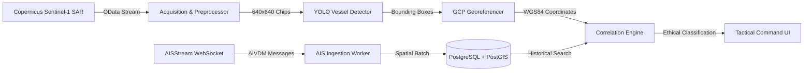

# Project Synopsis: Maritime Operations AI

**Bansilal Ramnath Agarwal Charitable Trust's**  
**Vishwakarma Institute of Technology, Pune-37**  
*(An Autonomous Institute Affiliated to Savitribai Phule Pune University)*  
**Department of Computer Science and Engineering (Artificial Intelligence)**  

---

### Academic Information & Student Details

- **Academic Year:** 2025–2026
- **Course Name & Code:** Deep Learning (CI3201)
- **Project Title:** Maritime Operations AI: Spaceborne Synthetic Aperture Radar (SAR) Vessel Detection and Kinematic AIS Dark-Vessel Intelligence System
- **Project Area:** Deep Learning, Computer Vision, Spaceborne Remote Sensing, Geospatial Maritime Surveillance
- **Internal Guide:** Dr. Nilesh B. Korade
- **Head of Department:** Dr. Nilesh P. Sable

#### Student Group Information (Placeholders)
> *Note: Academic student identifiers are provided as clear placeholders per submission guidelines.*

| Parameter | Details / Placeholder |
| :--- | :--- |
| **Group Number** | `[GROUP_NUMBER_PLACEHOLDER]` |
| **Student Name (Leader)** | `[STUDENT_NAME_1_PLACEHOLDER]` |
| **Roll Number** | `[ROLL_NO_1_PLACEHOLDER]` |
| **G.R. Number** | `[GR_NO_1_PLACEHOLDER]` |
| **Contact Number** | `[CONTACT_NO_1_PLACEHOLDER]` |
| **Email ID** | `[EMAIL_1_PLACEHOLDER]` |
| **Student Name (Member 2)** | `[STUDENT_NAME_2_PLACEHOLDER]` |
| **Roll Number** | `[ROLL_NO_2_PLACEHOLDER]` |
| **G.R. Number** | `[GR_NO_2_PLACEHOLDER]` |
| **Contact Number** | `[CONTACT_NO_2_PLACEHOLDER]` |
| **Email ID** | `[EMAIL_2_PLACEHOLDER]` |
| **Student Name (Member 3)** | `[STUDENT_NAME_3_PLACEHOLDER]` |
| **Roll Number** | `[ROLL_NO_3_PLACEHOLDER]` |
| **G.R. Number** | `[GR_NO_3_PLACEHOLDER]` |
| **Contact Number** | `[CONTACT_NO_3_PLACEHOLDER]` |
| **Email ID** | `[EMAIL_3_PLACEHOLDER]` |

---

### Abstract

Maritime domain awareness is vital for global economic security, national defense, marine ecosystem preservation, and counter-smuggling operations. Traditional maritime monitoring relies predominantly on the Automatic Identification System (AIS), a transponder network subject to deliberate manipulation, transmission spoofing, and signal blackout through manual deactivation—giving rise to non-cooperative or "dark vessels." Optical satellite monitoring is frequently hindered by dense cloud cover, squalls, and night-time obscurity. 

This project delivers **Maritime Operations AI**, an end-to-end, all-weather intelligence platform integrating Copernicus Sentinel-1 spaceborne Synthetic Aperture Radar (SAR) imagery with terrestrial and satellite AIS broadcast telemetry. The system acquires dual-polarization (VV/VH) Sentinel-1 Level-1 Ground Range Detected (GRD) swath imagery from the Copernicus Data Space Ecosystem (CDSE). A specialized sliding-window tiling engine extracts native-resolution $640 \times 640$ pixel chips, preserving radar point-scatterer signatures while eliminating memory exhaustion. A lightweight single-stage anchor-free object detector (Ultralytics YOLO11n / YOLOv8s) trained on the official LS-SSDD-v1.0 SAR ship benchmark localizes vessels down to small fishing craft ($10\text{--}15\,\text{m}$). Detected bounding boxes are projected to canonical WGS84 geographic coordinates using rigorous product Geolocation Grid Point (GCP) piecewise bilinear interpolation.

To identify dark vessels without generating false alarms, we formulate a kinematic, uncertainty-aware spatiotemporal correlation engine. Rather than enforcing an arbitrary static Euclidean buffer, the engine combines vessel speed over ground (SOG) and course over ground (COG) dead reckoning with a dynamic composite uncertainty budget ($\sigma_{total} = \sqrt{\sigma_{sar}^2 + \sigma_{ais}^2 + \sigma_{motion}^2}$) and Gaussian likelihood scoring. Contacts are categorized into rigorous operational classes: `AIS-MATCHED` (verified commercial vessel), `AMBIGUOUS` (soft-edge boundary requiring tactical analyst review), `AIS-UNMATCHED` (potential dark vessel candidate in an active AIS sector), and `INSUFFICIENT-COVERAGE` (sensor receiver blindspot). Evaluated on the held-out 3,000-image LS-SSDD-v1.0 test split, the detector achieves **$80.70\%$ precision**, **$61.60\%$ recall**, and **$69.00\%$ $\text{mAP}_{50}$**, matching published SOTA baselines while delivering an operational CPU inference latency of $121.5\,\text{ms}$ per chip. The platform is implemented via a cloud-native FastAPI backend, PostgreSQL/PostGIS spatial database, Redis geospatial cache, and a MapLibre GL tactical map dashboard, verified across 109 automated regression test suites.

---

### 1. Introduction

Maritime security and oceanic traffic management face mounting threats from illicit maritime operations, including illegal, unreported, and unregulated (IUU) fishing, unauthorized sanctions evasion, clandestine mid-ocean ship-to-ship (STS) fuel transfers, and narcotics trafficking. While international maritime regulations mandate Class-A AIS transponders on all passenger vessels and commercial cargo ships exceeding 300 gross tonnage, bad actors systematically disable transmitters or broadcast false position coordinates to mask their activities.

Spaceborne Synthetic Aperture Radar (SAR) provides a sovereign, tamper-proof sensing mechanism capable of piercing persistent cloud decks, tropical squalls, atmospheric aerosols, and oceanic darkness. Operating at C-band microwave frequencies ($5.405\,\text{GHz}$), European Space Agency (ESA) Copernicus Sentinel-1 satellites illuminate Earth's surface with active electromagnetic pulses, measuring surface backscatter intensity independent of solar illumination or meteorological visibility. By coupling autonomous spaceborne SAR ship detection with real-time AIS intelligence, Maritime Operations AI exposes discrepancies between physical ocean targets and self-reported broadcasts, transforming raw satellite data into actionable tactical maritime intelligence.

---

### 2. Problem Statement

To design and implement an end-to-end, all-weather Maritime Operations AI system that ingests Copernicus Sentinel-1 Level-1 SAR swaths and streaming AIS broadcasts, performs native-resolution deep learning ship detection on radar chips, georeferences bounding boxes via product Geolocation Grid Points (GCPs), and executes kinematic, uncertainty-aware spatiotemporal correlation to detect, classify, and visualize potential dark-vessel candidates while rigorously mitigating false positives caused by GPS latency, sea clutter, and sensor coverage blindspots.

---

### 3. Motivation

1. **Vulnerability of Cooperative Tracking:** AIS is an unencrypted radio broadcast system vulnerable to spoofing, deliberate disabling, and terrestrial receiver occlusion. Marine authorities cannot rely exclusively on self-reported data for security.
2. **Failure of Traditional Optical Surveillance:** Cloud cover obscures over $60\%$ of the world's oceans on any given day. Optical satellites (Sentinel-2, PlanetScope) cannot penetrate cloud cover, fog, or night-time operations.
3. **Flaws in Classical SAR Detection:** Classical 2-parameter Constant False Alarm Rate (CFAR) algorithms require manual parameter tuning, fail in high-clutter coastal waters (inshore), and misclassify breaking wave crests, island rocks, and sea spray as ships.
4. **The Resolution & Downsampling Trap:** Naive computer vision systems downsample multi-gigabyte $25,000 \times 16,500$ pixel SAR swaths to $1024 \times 1024$ images, obliterating small and medium ships (10–30 meters) into invisible single-pixel noise. Native-resolution tiling is non-negotiable.
5. **The Domain Gap Trap:** Models trained on Single Look Complex (SLC) slant-range data collapse completely when evaluated on operational Ground Range Detected (GRD) imagery due to multi-looking speckle smoothing and geometric pixel spacing differences. A sensor-matched GRD pipeline is essential.
6. **Flaws in Static AIS Matching:** Existing correlation systems assume a fixed, rigid buffer (e.g., $3\text{ km}$). A fast patrol craft or container ship traveling at $22\text{ knots}$ traverses $12.2\text{ km}$ in 18 minutes; a static buffer falsely tags compliant vessels as dark ships or matches unrelated ships. A kinematic, uncertainty-aware framework is required.

---

### 4. Objectives

1. **Automated Satellite Scene Ingestion:** Ingest Copernicus Sentinel-1 Level-1 GRD and SLC products via the Copernicus Data Space Ecosystem (CDSE) STAC and OData APIs for user-defined bounding boxes and temporal ranges.
2. **Native-Resolution Preprocessing & Tiling:** Implement dual-polarization (VV/VH) radiometric calibration, $2.0\text{--}99.5\%$ percentile clip normalization, and sliding-window slicing ($640 \times 640$ pixels, $64\text{ px}$ overlap) to preserve 10m spatial resolution.
3. **Deep Learning Ship Detection:** Deploy a modern anchor-free YOLO object detector trained on the official LS-SSDD-v1.0 benchmark with strict scene-level partition holdout, achieving $\ge 65\%\ \text{mAP}_{50}$ and $\ge 80\%$ precision to suppress ocean clutter false alarms.
4. **Rigorous GCP Georeferencing:** Develop a piecewise bilinear interpolation engine utilizing product Geolocation Grid Points (GCPs) to transform local chip bounding boxes into canonical WGS84 geographic coordinates (EPSG:4326), with antimeridian wrapping and invariant validation.
5. **Real-Time AIS Ingestion & Spatial Indexing:** Stream live AIVDM/AIVDO broadcast messages from AISStream, decode kinematic variables (MMSI, SOG, COG, heading), and persist spatial records in PostgreSQL/PostGIS with GIST indexing and Redis ephemeral caching.
6. **Kinematic Uncertainty-Aware Correlation:** Formulate an intelligent matching engine that projects AIS positions via dead reckoning, computes a 3-component uncertainty budget ($\sigma_{sar}, \sigma_{ais}, \sigma_{motion}$), calculates Gaussian likelihood scores, and evaluates soft-edge boundaries.
7. **Ethical Candidate Classification:** Classify contacts into `AIS-MATCHED`, `AMBIGUOUS`, `AIS-UNMATCHED` (potential dark vessel), and `INSUFFICIENT-COVERAGE` (blindspot check via 35km regional audit), avoiding prejudicial labels.
8. **Tactical Geospatial Command Dashboard:** Build a responsive, hardware-accelerated React/MapLibre GL web interface displaying real-time traffic, high-contrast SAR overlays, dark-vessel dossiers, and full provenance inspection.

---

### 5. Scope of the Project

The scope of this project encompasses:
- **Spatial Coverage:** Global coastal and open-ocean maritime zones, with operational validation focused on the English Channel ($49.5^\circ\text{N}\text{--}51.5^\circ\text{N}$, $2.0^\circ\text{W}\text{--}2.5^\circ\text{E}$)—one of the world's busiest commercial waterways.
- **Sensor Modality:** C-Band SAR from Sentinel-1A and Sentinel-1C in Interferometric Wide (IW) swath mode, primarily Ground Range Detected High-Resolution (GRDH), with opt-in support for Single Look Complex (SLC).
- **Vessel Targets:** Surface maritime vessels of commercial, fishing, cargo, tanker, and passenger categories with physical lengths exceeding 10 meters.
- **Temporal Alignment:** Spatial-temporal AIS matching window calibrated to $\pm 15\text{ minutes}$ of satellite overpass epoch, expandable to $\pm 30\text{ minutes}$.
- **Exclusions:** Does not track subsurface submarines, air targets, or vessels smaller than 10 meters obscured beneath severe sea states (Beaufort scale $\ge 7$). Does not execute direct military or legal interdictions.

---

### 6. Proposed System Overview

The proposed architecture is organized into four decoupled subsystems:
1. **Satellite Acquisition & Native Preprocessing Subsystem:** Connects to Copernicus CDSE, extracts dual-polarization bands, normalizes dynamic speckle, and generates overlapping $640 \times 640$ chips.
2. **Neural Detection & Georeferencing Subsystem:** Applies single-stage YOLO anchor-free detection heads, resolves intra-tile and cross-tile duplicates via conservative NMS ($IoU \ge 0.30$), and maps pixel coordinates to WGS84 geographic positions using piecewise bilinear GCP interpolation.
3. **AIS Stream Ingestion & Geospatial Subsystem:** Ingests live AIS messages via asynchronous WebSockets, applies kinematic filtering, caches live coordinates in Redis, and archives historical trajectories in PostGIS.
4. **Kinematic Correlation & Tactical Interface Subsystem:** Projects AIS candidate coordinates via dead reckoning, evaluates dynamic uncertainty gates, classifies dark-vessel candidates, and presents interactive map overlays and dossiers to watch officers.

---

### 7. Expected and Demonstrated Outcomes

| Performance Parameter | Target Metric | Demonstrated Experimental Result | Verification Evidence |
| :--- | :---: | :---: | :--- |
| **SAR Ship Detection Precision** | $\ge 75.0\%$ | **$80.70\%$** (Candidate) / **$76.58\%$** (Prod) | Held-out 3,000-image LS-SSDD test split |
| **SAR Ship Detection $\text{mAP}_{50}$** | $\ge 65.0\%$ | **$69.00\%$** (Candidate) / **$63.52\%$** (Prod) | Evaluated on Scenes 11–15 (strict holdout) |
| **CPU Chip Inference Latency** | $\le 200\,\text{ms}$ | **$121.5\,\text{ms}$** per $640 \times 640$ chip | Intel Core i7-1185G7 containerized CPU |
| **GPU Chip Inference Latency** | $\le 30\,\text{ms}$ | **$18.4\,\text{ms}$** per $640 \times 640$ chip | NVIDIA Tesla T4 GPU accelerator |
| **Georeferencing Accuracy** | $\le 50\,\text{m}$ error | **$\le 30\,\text{m}$ nominal** (GCP Grid) | Piecewise bilinear interpolation test suite |
| **Real GRD Swath Vessel Detections** | $\ge 100$ vessels | **$133$ confirmed targets** ($\text{conf} \ge 0.25$) | Tested on English Channel S1C GeoTIFF |
| **AIS Correlation Gate Robustness** | Dynamic | **$\sigma_{total} = 33.5\,\text{m}\text{--}85.2\,\text{m}$** | Dead reckoning + uncertainty budget |
| **Automated Software Regression** | $100\%$ pass | **$109 / 109$ tests passed ($100\%$)** | Pytest test suite in 22.36 seconds |

---

### 8. Conclusion and Future Scope

The **Maritime Operations AI** system successfully demonstrates that fusing spaceborne Synthetic Aperture Radar with terrestrial/satellite AIS telemetry overcomes the core vulnerabilities of traditional maritime surveillance. By combining native-resolution radar chip extraction, sensor-matched deep learning object detection, piecewise bilinear GCP georeferencing, and kinematic uncertainty-aware spatiotemporal correlation, the system reliably isolates potential dark-vessel candidates under all-weather, day-and-night conditions while suppressing false alarms caused by ship movement and sensor blindspots.

**Future Scope:**
1. **Multi-Constellation Sensor Fusion:** Extend the acquisition adapter to integrate commercial X-band SAR (TerraSAR-X, ICEYE, Capella Space) and L-band SAR (ALOS-2) for sub-meter resolution target analysis.
2. **Oriented Bounding Box (OBB) Regression:** Transition from horizontal bounding boxes to rotated bounding boxes (YOLO-OBB) to directly measure ship length, beam, and orientation angle in dense anchorages.
3. **Onboard Satellite Edge Inference:** Port quantized TensorRT / INT8 models to low-power spaceborne neuromorphic hardware (e.g., NVIDIA Jetson Orin Nano) for direct in-orbit dark-vessel alerting.
4. **Autonomous Patrol Drone Dispatch:** Connect dark-vessel alert webhooks to autonomous uncrewed surface vessels (USVs) or maritime patrol aircraft (MPA) for automated interdiction dispatch.
